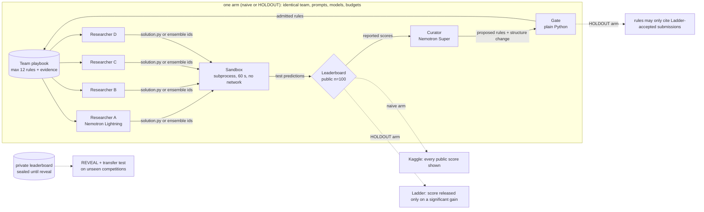

# HOLDOUT: Shake-Up

**Self-improving agents grade themselves on the scoreboard they optimize, so they learn the scoreboard, not the task.**
We built an AI Kaggle team on Crusoe Managed Inference (all Nemotron), show the leaderboard shake-up when its
"improvements" meet the private leaderboard, and fix it with a principled gate (the Ladder, Blum and Hardt 2015)
so the team only keeps changes that are real.

Track: **Version N+1**. Built today (Oct 17 2026) at The Recursive Agents Hackathon, Crusoe x Cerebral Valley, Shack15 SF.

---

## Why this matters

- Karpathy's autoresearch (Mar 2026) made the loop popular: an agent edits code, runs an experiment, checks a validation
  score, and keeps the change if the score went up. That keep-if-it-went-up rule is exactly the Kaggle public-leaderboard rule.
- Sakana's Darwin Gödel Machine (2025) reported "objective hacking": a self-improving agent raised its score by removing
  the logging its hallucination checker depended on.
- On Kaggle, teams that overfit the small public leaderboard drop when the private leaderboard is revealed ("shake-up").
- Blum and Hardt (ICML 2015, arXiv 1502.04585) showed a *boosting attack* that climbs a public leaderboard with zero
  skill, and proposed the **Ladder**, a leaderboard that stays accurate under adaptive reuse. As far as we know nobody has
  used it as the keep/discard gate of a self-improving agent team. That is what we built.

## What we built (all of it today)



| Component | File | What it does |
|---|---|---|
| Crusoe client | `holdout/llm.py` | OpenAI SDK against Crusoe, concurrency cap, adaptive pacing + backoff on 429, disk cache for replay, per-call usage / cached-token / $ log, $15 budget stop |
| Competitions | `holdout/data.py` | 5 OpenML datasets, per-seed split: train 50%, public 100 rows, private the rest, test rows shuffled together like Kaggle |
| Leaderboards | `holdout/leaderboard.py` | Kaggle mechanism and the parameter-free Ladder implemented from Figure 2 of the paper |
| Boosting-attack bot | `holdout/boosting_bot.py` | Non-LLM random-label attack from Section 5 of the paper, run against both boards |
| Sandbox | `holdout/sandbox.py` | Runs agent code in a subprocess, 60 s timeout, stripped env, macOS `sandbox-exec` network deny + socket guard; agents never see test labels |
| Researcher | `holdout/researcher.py` | One research trajectory; shared-prefix prompt layout for MemoryAlloy; writes `solution.py` or calls `ensemble(ids)` |
| Curator | `holdout/curator.py` | Rewrites the playbook each round (max 12 rules with evidence), proposes one team-structure change |
| Gate | `holdout/gate.py` | Plain-Python admission rule: HOLDOUT rules may only cite Ladder-accepted submissions |
| Arena | `holdout/arena.py` | Rounds, two arms in parallel, structure keep/revert, final selection, private reveal, event log for replay |
| Transfer test | `holdout/transfer.py` | gen-0 vs naive-final vs HOLDOUT-final playbooks on unseen competitions |
| Cache probe | `holdout/cache_probe.py` | Measures MemoryAlloy prefix reuse (cached tokens and time-to-first-token) |
| Report | `holdout/report.py` | `results/results.json`, charts, markdown tables, all computed from logs |
| Demo | `demo.py` | `rich` terminal replay / live run with gate verdicts and the REVEAL PRIVATE shake-up |
| Tests | `tests/` | Ladder/Kaggle properties, sandbox isolation, gate rules, and a sealing test that fails if any agent prompt contains private labels, sealed scores or unseen-competition data |

### Provenance
Nothing was imported from our other project built today (`proof-of-done`). The only thing reused is the Crusoe API key
from its `.env`, and NOTES.md re-verifies the live model list from scratch. Every line in this repo was written today; see the commit history.

## How each feature maps to the Version N+1 brief

| Brief | HOLDOUT |
|---|---|
| reviews each run | the curator reads every round's results as reported by its arm's leaderboard |
| rewrites its own prompts / playbooks / tools / structure | the curator rewrites the playbook every researcher reads next round, and can reassign researcher directions (their prompts), change submissions per researcher, or add/remove a researcher |
| keeps a change only if it measurably helps | HOLDOUT: a playbook rule is admitted only if it cites a submission the Ladder accepted as a significant gain; a structure change is kept only if the next round produces a Ladder-accepted improvement, otherwise reverted |
| proves it with a before/after on tasks it has not seen | transfer test: gen-0 vs evolved playbooks on two competitions never opened during learning, scored on private rows |

## Results

All numbers below are generated by `python -m holdout.report` from `results/results.json`. Nothing is typed by hand.

<!-- RESULTS:START -->
### Shake-up: final selection per arm (seed 0)

| Competition | Arm | Final pick | Reported public | Private | Inflation | Private rank of pick | Spearman(public, private) |
|---|---|---|---|---|---|---|---|
| credit-g | Naive (Kaggle board) | cg.R2.B2 (code) | 0.700 | 0.715 | -0.015 | 16/19 | -0.60 |
| credit-g | HOLDOUT (Ladder + gate) | cg.R1.A1 (code) | 0.690 | 0.720 | -0.030 | 13/16 | -0.27 |
| diabetes | Naive (Kaggle board) | db.R1.B2 (code) | 0.870 | 0.746 | +0.124 | 4/20 | 0.53 |
| diabetes | HOLDOUT (Ladder + gate) | db.R1.C1 (code) | 0.840 | 0.729 | +0.111 | 11/11 | -0.23 |
| phoneme | Naive (Kaggle board) | ph.R2.D2 (code) | 0.840 | 0.892 | -0.052 | 1/12 | 1.00 |
| phoneme | HOLDOUT (Ladder + gate) | ph.R1.C2 (code) | 0.860 | 0.872 | -0.012 | 6/20 | 0.88 |
| **mean** | Naive (Kaggle board) | | 0.803 | 0.785 | +0.019 | | |
| **mean** | HOLDOUT (Ladder + gate) | | 0.797 | 0.774 | +0.023 | | |

### Gate log

| Arm | Rules proposed | Admitted | Rejected | Evidence ids stripped | Structure changes (kept / reverted / invalid) |
|---|---|---|---|---|---|
| Naive (Kaggle board) | 60 | 60 | 0 | 1 | 0 / 1 / 0 |
| HOLDOUT (Ladder + gate) | 26 | 12 | 14 | 45 | 0 / 0 / 0 |

### Same submissions, two selection rules (2000 redraws of the n=100 public set)

Each team's real submissions are held fixed; only which 100 test rows are public changes. This ignores adaptivity, so it understates the naive team's overfitting.

| Submission pool | Competition | Seed | Subs | Kaggle rule: reported / private / inflation | Ladder rule: reported / private / inflation |
|---|---|---|---|---|---|
| holdout team | credit-g | 0 | 16 | 0.779 / 0.737 / +0.042 | 0.767 / 0.727 / +0.040 |
| holdout team | diabetes | 0 | 11 | 0.796 / 0.770 / +0.026 | 0.789 / 0.768 / +0.021 |
| holdout team | phoneme | 0 | 20 | 0.895 / 0.877 / +0.018 | 0.890 / 0.876 / +0.013 |
| naive team | credit-g | 0 | 19 | 0.759 / 0.718 / +0.041 | 0.746 / 0.715 / +0.031 |
| naive team | diabetes | 0 | 20 | 0.791 / 0.768 / +0.023 | 0.784 / 0.765 / +0.019 |
| naive team | phoneme | 0 | 12 | 0.891 / 0.890 / +0.001 | 0.891 / 0.890 / +0.001 |
| **mean** | | | | 0.818 / 0.793 / +0.025 | 0.811 / 0.790 / +0.021 |

### Boosting attack (random labels, no skill)

credit-g, public n=100, private n=400, k=400 random submissions, mean of 30 runs.

| Board | Reported public | Private |
|---|---|---|
| kaggle | 0.871 | 0.516 |
| ladder | 0.636 | 0.529 |

### Efficiency (Crusoe Managed Inference, all Nemotron)

| Scope | Live LLM calls | Prompt tokens | Completion tokens | Est. cost |
|---|---|---|---|---|
| Arena run `m2` (both arms, 3 competitions x 4 rounds) | 202 | 445,584 | 125,231 | $0.082 |
| Everything today (incl. smoke tests, aborted runs) | 585 | | | $0.206 |

Cached-token share reported by Crusoe in `usage.prompt_tokens_details`: 0.003 (Lightning returns `null` for this field, so this undercounts; see the cache probe).
HOLDOUT final picks beat a plain logistic-regression baseline by 3.22 private-accuracy points on average (baseline 0.741), at $0.0255 of arena inference per point.

<!-- RESULTS:END -->

## How to run

```bash
python3 -m venv .venv && .venv/bin/pip install -r requirements.txt
cp .env.example .env            # add CRUSOE_API_KEY
.venv/bin/python -m holdout.check                 # list live Crusoe models, smoke-test both Nemotron roles
.venv/bin/python -m pytest -q tests               # offline tests
.venv/bin/python -m holdout.boosting_bot          # boosting attack chart (no LLM)
.venv/bin/python -m holdout.arena --run-id m2     # both arms on the 3 dev competitions
.venv/bin/python -m holdout.transfer --from-run m2
.venv/bin/python -m holdout.report
.venv/bin/python demo.py --replay runs/m2         # offline replay, press Enter for REVEAL PRIVATE
.venv/bin/python demo.py --live --rounds 1        # one small live round on Crusoe
```

Replays need no network and no API key. LLM responses are cached on disk (`cache/`, gitignored), so a rerun of the
same run is free and deterministic.

## Sponsor usage

- **Crusoe Managed Inference** serves every LLM call (OpenAI-compatible endpoint `https://api.inference.crusoecloud.com/v1`).
- **NVIDIA Nemotron** runs every agent role: researchers on `nvidia/Nemotron-3.5-Lightning-30B-A3B`, curator on
  `nvidia/NVIDIA-Nemotron-3-Super-120B-A12B`. This follows Crusoe's tiering (big Nemotron orchestrates, small Nemotron
  works). Nemotron 3 Ultra was not live on our project's `/v1/models`, so the curator uses the largest live Nemotron.
- **MemoryAlloy prompt design**: every researcher in a round sends a byte-identical prefix (system prompt + tool schema +
  playbook + competition card + leaderboard snapshot) and the researcher-specific part goes last. See the efficiency section.

## Datasets and licences

All from OpenML, fetched with `sklearn.datasets.fetch_openml(data_id=...)`. OpenML lists the licence of each as "Public".

| Dataset | OpenML id | Rows | Role |
|---|---|---|---|
| credit-g | [31](https://www.openml.org/d/31) | 1000 | dev |
| diabetes | [37](https://www.openml.org/d/37) | 768 | dev |
| phoneme | [1489](https://www.openml.org/d/1489) | 5404 | dev |
| qsar-biodeg | [1494](https://www.openml.org/d/1494) | 1055 | unseen (transfer only) |
| blood-transfusion-service-center | [1464](https://www.openml.org/d/1464) | 748 | unseen (transfer only) |

## Honest limitations

- **The public leaderboard is deliberately small (n=100).** That is realistic for agent evals and it is what makes
  adaptive overfitting visible. With n=100 the Ladder's significance step is about 0.05 to 0.07, so it also leaks a little
  under a determined attacker (see the boosting chart): it limits overfitting, it does not remove it.
- **Few seeds, small N.** One split seed per competition for the arms unless stated otherwise; LLM sampling (temperature 0.7) adds variance.
- **LLM nondeterminism.** Reruns hit the disk cache, so replays are exact, but a fresh run will differ.
- **Accuracy only**, matching the Ladder paper.
- **Transfer is measured on two unseen datasets**, one fresh round each. It is a sanity check, not a benchmark.
- Researchers on the small model write failing code often; failures are logged and never reach the leaderboard.

## FAQ

- **Isn't this just autoresearch?** Autoresearch keeps a change when validation improves, which is the Kaggle mechanism.
  We show that rule fools an agent team, and replace it with a mechanism the team cannot game cheaply.
- **Why not just use a bigger validation set?** It helps, but adaptive reuse still overfits, and real agents usually have
  small evals. The Ladder has guarantees under adaptive reuse.
- **Does the gate slow real progress?** Compare the private scores of both arms and the transfer table above.
- **Where is the N+1?** Every round the team rewrites its playbook and structure; only gated changes survive; the evolved
  playbook is tested on competitions it never saw.
- **Why Crusoe?** The shared-prefix prompt layout is built for MemoryAlloy's cluster-wide KV cache, and the role tiering
  (Nemotron Super orchestrates, Nemotron Lightning researchers) follows Crusoe's recommendation.
- **Research angle.** The swarm out-generates its verifier (the public leaderboard): a generation-verification gap.
  HOLDOUT closes the gap with a verifier the swarm cannot cheaply game.
