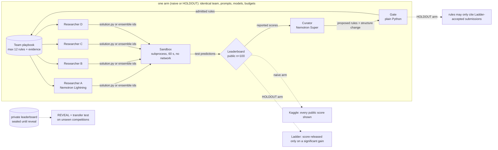
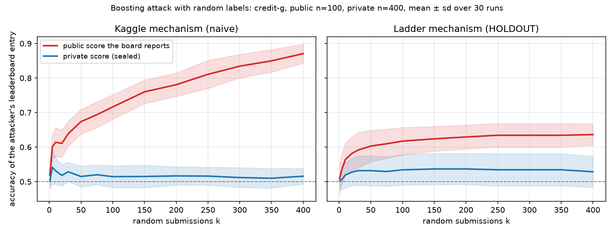
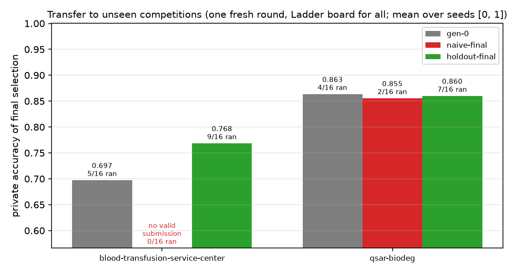
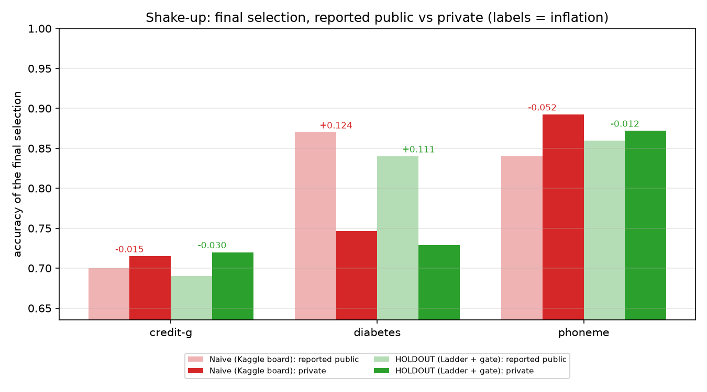
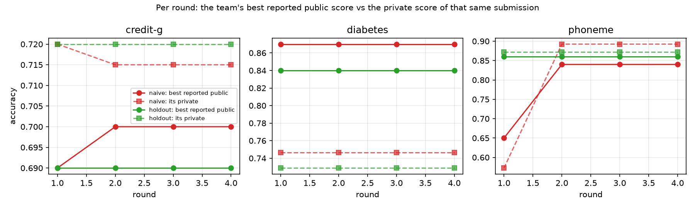

# HOLDOUT: Shake-Up

**Self-improving agents grade themselves on the scoreboard they optimize, so they learn the scoreboard, not the task.**
We built an AI Kaggle team on Crusoe Managed Inference (all Nemotron), show the leaderboard shake-up when its
"improvements" meet the private leaderboard, and fix it with a principled gate (the Ladder, Blum and Hardt 2015)
so the team only keeps changes that are real.

Track: **Version N+1**. Built today (Oct 17 2026) at The Recursive Agents Hackathon, Crusoe x Cerebral Valley, Shack15 SF.

---

## Why this matters

- Karpathy's autoresearch (Mar 2026) made the loop popular: an agent edits code, runs an experiment, checks a validation
  score, and keeps the change if the score went up. That keep-if-it-went-up rule is exactly the Kaggle public-leaderboard rule.
- Sakana's Darwin Gödel Machine (2025) reported "objective hacking": a self-improving agent raised its score by removing
  the logging its hallucination checker depended on.
- On Kaggle, teams that overfit the small public leaderboard drop when the private leaderboard is revealed ("shake-up").
- Blum and Hardt (ICML 2015, arXiv 1502.04585) showed a *boosting attack* that climbs a public leaderboard with zero
  skill, and proposed the **Ladder**, a leaderboard that stays accurate under adaptive reuse. As far as we know nobody has
  used it as the keep/discard gate of a self-improving agent team. That is what we built.

## How we got here (the design story)

This project came out of a long team discussion about a *different* design: a self-improving "shared brain" research
swarm. HOLDOUT keeps almost all of that design and fixes the one weakness we found in it. Here is the path, so anyone
reading the repo can follow the reasoning. Numbers are in the Results section, where they are generated from logs.

### 1. Where the team started: a research swarm with a shared brain

- **Pick a task with a number.** We dropped ideas where "better" is subjective (negotiation, dating, insurance
  interpretation) and settled on improving an existing ML benchmark, because validation and test accuracy are objective.
- **Two kinds of compute.** LLM reasoning (understand the problem, form hypotheses, write sklearn code, reflect) runs on
  Crusoe inference. Running the candidate models does not need an LLM: the agent writes Python, a **sandbox** executes it
  and returns a metric. The sandbox is a deterministic worker, not another agent.
- **A researcher is a trajectory, not one experiment.** Each researcher gets a budget and loops: think, write a
  candidate, run it, read the score, revise, keep its best. It dies when the budget runs out.
- **A population, for diversity.** One lucky sequential run proves nothing. Parallel researchers with different
  directions (feature engineering, model family, tuning, ensembling) explore different hypotheses.
- **Agents read the shared memory; a curator writes it.** Dumping every transcript into the next generation is huge,
  noisy and makes everyone converge. Instead a curator reads the ranked results and compresses what worked and what
  failed into inherited knowledge. *Agents die; useful knowledge survives.*
- **Budget is a first-class parameter**, so "better" is never just "spent more".
- **Train / validation / test.** Researchers fit on train and see validation scores repeatedly. The test set stays
  hidden, including from the curator, until the final candidate is frozen.

### 2. The crack: the swarm keeps whatever the validation score rewards

Looking hard at that last point is what led to HOLDOUT. In the swarm design, researchers check the validation score
again and again, and the curator promotes "what worked" by validation score. That is exactly a Kaggle public
leaderboard, and exactly the keep-if-the-score-went-up rule of autoresearch-style loops. Under adaptive reuse a
validation score stops being an honest estimate:

- a small validation set rewards lucky noise, and the selected "best" is biased upward (winner's curse);
- a bigger population makes this *worse*: more researchers means more lucky winners to promote;
- the curator writes those lucky wins into the shared brain, so the next generation inherits noise as "knowledge".

In other words, the swarm out-generates its own verifier. Blum and Hardt had already shown the extreme case (a boosting
attack that climbs a leaderboard with random guesses) and a fix (the Ladder).

### 3. The pivot: make the verifier the product

We kept the swarm (researchers, sandbox, curator, playbook as the shared brain, sealed test set) and changed exactly one
thing, in two arms that are otherwise identical: same models, prompts, researchers, rounds and budgets.

- **Naive arm:** every submission's public score is shown; the curator may cite any reported gain.
- **HOLDOUT arm:** the public score is released by the Ladder (only significant gains move it), and a plain-Python gate
  admits a playbook rule only if it cites a submission the Ladder accepted. Structure changes are kept only if the next
  round produces a Ladder-accepted gain.

The public set is deliberately small (100 rows), because that is what agent evals usually look like and what makes
adaptive overfitting visible. The private rows play the role of the hidden test set. Two competitions are kept sealed
for a transfer test: does what the team learned help on tasks it has never seen?

### 4. Build order, and why

1. **Crusoe first.** We listed the live models instead of trusting docs. Nemotron 3 Ultra was not live for us, so the
   curator runs on the largest live Nemotron (Super) and the researchers on Nemotron Lightning.
2. **The Ladder, implemented from Figure 2 of the paper, with tests**, next to the Kaggle mechanism.
3. **The boosting-attack bot before any LLM.** A non-LLM attacker has to show the effect first. If random guesses could
   not climb the Kaggle board and stall on the Ladder, no LLM result would mean anything.
4. **Then the agent team**, two arms in parallel, every event logged so the demo can replay it offline.
5. **Then transfer, a second split seed, a MemoryAlloy cache probe, and an NVIDIA OpenShell sandbox backend.**

### 5. What broke while running, and what we changed

- **The gate rejected everything in round 2.** The curator copied evidence as `cg.R1.A1 (0.69000)`; the gate did not
  recognise the decorated ids. Fixed by normalising ids (with a test). The run was discarded, not reported.
- **HOLDOUT was wiping its own verified rules.** When the curator kept an old rule it swapped in only the new round's ids,
  so the gate dropped rules whose real evidence was from earlier rounds. We told the curator (in both arms, identically)
  to carry evidence forward, and restarted. That run was also discarded.
- **Rate limits.** We shared one Crusoe key with another project, so we added adaptive pacing and patient retries,
  then gave this project its own key. Nemotron Super still throttled at times, so curator calls now fall back to another
  Nemotron after repeated 429s, and the log records which model answered.
- **The small researcher model writes a lot of failing code.** Failures are logged and never reach the leaderboard.
  This turned out to matter: it is how the naive playbook's bad advice showed up on unseen competitions.

### 6. What the data actually said

- The mechanism works where theory says it should: against the zero-skill boosting attack the Ladder holds the reported
  score far lower than the Kaggle board.
- With real LLM researchers the final-pick shake-up was small and mixed. Their submissions are highly correlated, so
  they are much less adversarial than the attack. We report this rather than hide it.
- The big difference is **what each team learns**. The naive curator admits essentially every rule; the gate rejects
  rules whose evidence was noise. On the sealed competitions, code written from the naive playbook rarely ran, while the
  gated playbook transferred better than an empty one.

### 7. Where this goes next

The Ladder plus an evidence gate is a drop-in keep/discard rule for any self-improving loop (autoresearch, prompt or
playbook evolution, agent-written tools). It should matter *more* as populations grow, because more researchers means
more lucky winners. Next: larger populations and more seeds, Thresholdout as a second gate, researcher web search with a
contamination guard, and every experiment run inside OpenShell.

## What we built (all of it today)



| Component | File | What it does |
|---|---|---|
| Crusoe client | `holdout/llm.py` | OpenAI SDK against Crusoe, concurrency cap, adaptive pacing + backoff on 429, disk cache for replay, per-call usage / cached-token / $ log, $15 budget stop |
| Competitions | `holdout/data.py` | 5 OpenML datasets, per-seed split: train 50%, public 100 rows, private the rest, test rows shuffled together like Kaggle |
| Leaderboards | `holdout/leaderboard.py` | Kaggle mechanism and the parameter-free Ladder implemented from Figure 2 of the paper |
| Boosting-attack bot | `holdout/boosting_bot.py` | Non-LLM random-label attack from Section 5 of the paper, run against both boards |
| Sandbox | `holdout/sandbox.py` | Runs agent code in a subprocess, 60 s timeout, stripped env, macOS `sandbox-exec` network deny + socket guard; agents never see test labels. `SANDBOX=openshell` runs the same code inside NVIDIA OpenShell instead |
| OpenShell setup | `holdout/openshell_setup.py` | Creates the `holdout-sbx` OpenShell sandbox and installs pinned Linux wheels offline (the sandbox has no network) |
| Researcher | `holdout/researcher.py` | One research trajectory; shared-prefix prompt layout for MemoryAlloy; writes `solution.py` or calls `ensemble(ids)` |
| Curator | `holdout/curator.py` | Rewrites the playbook each round (max 12 rules with evidence), proposes one team-structure change |
| Gate | `holdout/gate.py` | Plain-Python admission rule: HOLDOUT rules may only cite Ladder-accepted submissions |
| Arena | `holdout/arena.py` | Rounds, two arms in parallel, structure keep/revert, final selection, private reveal, event log for replay |
| Transfer test | `holdout/transfer.py` | gen-0 vs naive-final vs HOLDOUT-final playbooks on unseen competitions |
| Cache probe | `holdout/cache_probe.py` | Measures MemoryAlloy prefix reuse (cached tokens and time-to-first-token) |
| Report | `holdout/report.py` | `results/results.json`, charts, markdown tables, all computed from logs |
| Demo | `demo.py` | `rich` terminal replay / live run with gate verdicts and the REVEAL PRIVATE shake-up |
| Demo video | `video/make_video.py` | Renders the 60 s demo video from real `demo.py` frames and `results/` (`video/holdout_demo.mp4`, script in `video_script.md`) |
| Tests | `tests/` | Ladder/Kaggle properties, sandbox isolation, gate rules, and a sealing test that fails if any agent prompt contains private labels, sealed scores or unseen-competition data |

### Provenance
No code was imported from our other project built today (`proof-of-done`). Early runs used that project's Crusoe API key
(this project now has its own key); NOTES.md re-verifies the live model list from scratch. The OpenShell backend follows
the same upload / `sandbox exec` pattern as proof-of-done's OpenShell sandbox, but the code here is new and uses its own
sandbox (`holdout-sbx`). Every line in this repo was written today; see the commit history.

## How each feature maps to the Version N+1 brief

| Brief | HOLDOUT |
|---|---|
| reviews each run | the curator reads every round's results as reported by its arm's leaderboard |
| rewrites its own prompts / playbooks / tools / structure | the curator rewrites the playbook every researcher reads next round, and can reassign researcher directions (their prompts), change submissions per researcher, or add/remove a researcher |
| keeps a change only if it measurably helps | HOLDOUT: a playbook rule is admitted only if it cites a submission the Ladder accepted as a significant gain; a structure change is kept only if the next round produces a Ladder-accepted improvement, otherwise reverted |
| proves it with a before/after on tasks it has not seen | transfer test: gen-0 vs evolved playbooks on two competitions never opened during learning, scored on private rows |

## Results

All numbers below are generated by `python -m holdout.report --arena m2 --transfer transfer --seeds-runs m2,m2s1`
from `results/results.json`. Nothing in this block is typed by hand.

| | |
|---|---|
|  |  |
|  |  |

<!-- RESULTS:START -->
### Key findings (generated from results.json)

1. **The mechanism works against a zero-skill attacker.** 400 random label vectors: the Kaggle board reports 0.871 public while private is 0.516 (inflation +0.355); the Ladder reports 0.636 vs 0.529 (+0.108). With n=100 the Ladder limits the climb but does not remove it.
2. **The gate changes what the team learns.** Over 2 split seeds the naive curator got 135/135 proposed playbook rules admitted; the HOLDOUT gate admitted 43/76 and stripped 114 citations of submissions whose "gain" the Ladder judged to be noise.
3. **Learned noise hurts on unseen competitions.** One fresh round on 2 unseen competitions x 2 seeds: submissions that ran: gen-0 9/32, naive-final 2/32, HOLDOUT-final 16/32. Mean private accuracy of the final pick: gen-0 0.780 (4/4 cells with a valid pick), naive-final 0.855 (2/4), HOLDOUT-final 0.814 (4/4). The naive playbook (every reported gain admitted) steered researchers to HistGradientBoosting with native categorical handling; on all-numeric blood-transfusion every naive-final submission failed in the sandbox, in both seeds.
4. **The final-pick shake-up with real LLM teams was small and mixed** (reported honestly). Pooled over 6 competition x seed cells, inflation of the final pick was +0.028 ± 0.061 (naive) vs +0.033 ± 0.055 (HOLDOUT): no clear difference at this N. Holding the submissions fixed and redrawing the public set 2000 times, the Ladder selection rule cut inflation from +0.027 to +0.021 at a private cost of -0.1 points. LLM submissions are highly correlated, so they are far less adversarial than the boosting attack.
5. **Cheap on Crusoe.** The full two-arm arena run cost $0.082 (202 live Nemotron calls); everything today including smoke tests $0.23. MemoryAlloy: with a shared prefix, Nemotron Super reported 3456 of 4118 prompt tokens cached (0 with unique prefixes); Lightning's median time-to-first-token was 0.325 s shared vs 0.408 s unique.

### Shake-up: final selection per arm (seed 0)

| Competition | Arm | Final pick | Reported public | Private | Inflation | Private rank of pick | Spearman(public, private) |
|---|---|---|---|---|---|---|---|
| credit-g | Naive (Kaggle board) | cg.R2.B2 (code) | 0.700 | 0.715 | -0.015 | 16/19 | -0.60 |
| credit-g | HOLDOUT (Ladder + gate) | cg.R1.A1 (code) | 0.690 | 0.720 | -0.030 | 13/16 | -0.27 |
| diabetes | Naive (Kaggle board) | db.R1.B2 (code) | 0.870 | 0.746 | +0.124 | 4/20 | 0.53 |
| diabetes | HOLDOUT (Ladder + gate) | db.R1.C1 (code) | 0.840 | 0.729 | +0.111 | 11/11 | -0.23 |
| phoneme | Naive (Kaggle board) | ph.R2.D2 (code) | 0.840 | 0.892 | -0.052 | 1/12 | 1.00 |
| phoneme | HOLDOUT (Ladder + gate) | ph.R1.C2 (code) | 0.860 | 0.872 | -0.012 | 6/20 | 0.88 |
| **mean** | Naive (Kaggle board) | | 0.803 | 0.785 | +0.019 | | |
| **mean** | HOLDOUT (Ladder + gate) | | 0.797 | 0.774 | +0.023 | | |

### Gate log

| Arm | Rules proposed | Admitted | Rejected | Evidence ids stripped | Structure changes (kept / reverted / invalid) |
|---|---|---|---|---|---|
| Naive (Kaggle board) | 60 | 60 | 0 | 1 | 0 / 1 / 0 |
| HOLDOUT (Ladder + gate) | 26 | 12 | 14 | 45 | 0 / 0 / 0 |

### Transfer to unseen competitions (Ladder board for all three)

Cells: private accuracy of the final selection (submissions that ran / submitted). 'no valid submission' means every researcher's code failed in the sandbox.

| Competition | Seed | gen-0 (empty) | naive-final | HOLDOUT-final |
|---|---|---|---|---|
| blood-transfusion-service-center | 0 | 0.748 (3/8 ran) | no valid submission (0/8 ran) | 0.781 (5/8 ran) |
| blood-transfusion-service-center | 1 | 0.646 (2/8 ran) | no valid submission (0/8 ran) | 0.755 (4/8 ran) |
| qsar-biodeg | 0 | 0.862 (2/8 ran) | 0.848 (1/8 ran) | 0.860 (3/8 ran) |
| qsar-biodeg | 1 | 0.864 (2/8 ran) | 0.862 (1/8 ran) | 0.860 (4/8 ran) |
| **mean of valid picks** | | 0.780 over 4/4 cells | 0.855 over 2/4 cells | 0.814 over 4/4 cells |
| **submissions that ran** | | 9/32 | 2/32 | 16/32 |

### Same submissions, two selection rules (2000 redraws of the n=100 public set)

Each team's real submissions are held fixed; only which 100 test rows are public changes. This ignores adaptivity, so it understates the naive team's overfitting.

| Submission pool | Competition | Seed | Subs | Kaggle rule: reported / private / inflation | Ladder rule: reported / private / inflation |
|---|---|---|---|---|---|
| holdout team | credit-g | 0 | 16 | 0.779 / 0.737 / +0.042 | 0.767 / 0.727 / +0.040 |
| holdout team | credit-g | 1 | 15 | 0.762 / 0.717 / +0.044 | 0.750 / 0.720 / +0.030 |
| holdout team | diabetes | 0 | 11 | 0.796 / 0.770 / +0.026 | 0.789 / 0.768 / +0.021 |
| holdout team | diabetes | 1 | 21 | 0.769 / 0.733 / +0.035 | 0.761 / 0.743 / +0.018 |
| holdout team | phoneme | 0 | 20 | 0.895 / 0.877 / +0.018 | 0.890 / 0.876 / +0.013 |
| holdout team | phoneme | 1 | 14 | 0.919 / 0.898 / +0.021 | 0.914 / 0.896 / +0.018 |
| naive team | credit-g | 0 | 19 | 0.759 / 0.718 / +0.041 | 0.746 / 0.715 / +0.031 |
| naive team | credit-g | 1 | 23 | 0.765 / 0.733 / +0.032 | 0.754 / 0.727 / +0.027 |
| naive team | diabetes | 0 | 20 | 0.791 / 0.768 / +0.023 | 0.784 / 0.765 / +0.019 |
| naive team | diabetes | 1 | 22 | 0.747 / 0.723 / +0.023 | 0.739 / 0.716 / +0.023 |
| naive team | phoneme | 0 | 12 | 0.891 / 0.890 / +0.001 | 0.891 / 0.890 / +0.001 |
| naive team | phoneme | 1 | 17 | 0.903 / 0.888 / +0.015 | 0.899 / 0.891 / +0.008 |
| **mean** | | | | 0.814 / 0.788 / +0.027 | 0.807 / 0.786 / +0.021 |

### NVIDIA OpenShell run (`runs/openshell_r1`)

One full round on diabetes, both arms, with every agent-written solution executed inside an OpenShell sandbox: 16 submissions, 10 ran successfully (the rest are researcher code errors), mean 2.35 s per sandbox execution, 19.5 s wall time.

| Arm | Final pick | Reported public | Private |
|---|---|---|---|
| naive | db.R1.B2 | 0.890 | 0.739 |
| holdout | db.R1.D1 | 0.830 | 0.771 |

### Boosting attack (random labels, no skill)

credit-g, public n=100, private n=400, k=400 random submissions, mean of 30 runs.

| Board | Reported public | Private |
|---|---|---|
| kaggle | 0.871 | 0.516 |
| ladder | 0.636 | 0.529 |

### Efficiency (Crusoe Managed Inference, all Nemotron)

| Scope | Live LLM calls | Prompt tokens | Completion tokens | Est. cost |
|---|---|---|---|---|
| Arena run `m2` (both arms, 3 competitions x 4 rounds) | 202 | 445,584 | 125,231 | $0.082 |
| Transfer run | 67 | 107,983 | 39,632 | $0.013 |
| Everything today (incl. smoke tests, aborted runs) | 639 | | | $0.232 |

Cached-token share reported by Crusoe in `usage.prompt_tokens_details`: 0.0027 (Lightning returns `null` for this field, so this undercounts; see the cache probe).
HOLDOUT final picks beat a plain logistic-regression baseline by 3.22 private-accuracy points on average (baseline 0.741), at $0.0255 of arena inference per point.
- Cache probe `nvidia/Nemotron-3.5-Lightning-30B-A3B`: median time-to-first-token 0.325 s with a shared ~4118-token prefix vs 0.408 s with unique prefixes; cached_tokens reported: shared [None, None, None, None, None, None], unique [None, None, None, None, None, None].
- Cache probe `nvidia/NVIDIA-Nemotron-3-Super-120B-A12B`: median time-to-first-token 0.536 s with a shared ~4118-token prefix vs 0.566 s with unique prefixes; cached_tokens reported: shared [3456, 3456, 3456, 3456, 3456, 3456], unique [0, 0, 0, 0, 0, 0].

### Pooled over split seeds (final selection, every dev competition x seed)

| Arm | n | Reported public | Private | Inflation (mean ± sd) |
|---|---|---|---|---|
| Naive (Kaggle board) | 6 | 0.808 | 0.780 | +0.028 ± 0.061 |
| HOLDOUT (Ladder + gate) | 6 | 0.810 | 0.777 | +0.033 ± 0.055 |

<!-- RESULTS:END -->

## How to run

```bash
python3 -m venv .venv && .venv/bin/pip install -r requirements.txt
cp .env.example .env            # add CRUSOE_API_KEY
.venv/bin/python -m holdout.check                 # list live Crusoe models, smoke-test both Nemotron roles
.venv/bin/python -m pytest -q tests               # offline tests
.venv/bin/python -m holdout.boosting_bot          # boosting attack chart (no LLM)
.venv/bin/python -m holdout.arena --run-id m2     # both arms on the 3 dev competitions
.venv/bin/python -m holdout.transfer --from-run m2
.venv/bin/python -m holdout.report
.venv/bin/python demo.py --replay runs/m2         # offline replay, press Enter for REVEAL PRIVATE
.venv/bin/python demo.py --live --rounds 1        # one small live round on Crusoe
SANDBOX=openshell .venv/bin/python demo.py --live --rounds 1   # same, agent code inside NVIDIA OpenShell
```

Demo video: [`video/holdout_demo.mp4`](video/holdout_demo.mp4) (60 s, rendered by `python video/make_video.py`).

Replays need no network and no API key. LLM responses are cached on disk (`cache/`, gitignored), so a rerun of the
same run is free and deterministic.

## Sponsor usage

- **Crusoe Managed Inference** serves every LLM call (OpenAI-compatible endpoint `https://api.inference.crusoecloud.com/v1`).
- **NVIDIA Nemotron** runs every agent role: researchers on `nvidia/Nemotron-3.5-Lightning-30B-A3B`, curator on
  `nvidia/NVIDIA-Nemotron-3-Super-120B-A12B`. This follows Crusoe's tiering (big Nemotron orchestrates, small Nemotron
  works). Nemotron 3 Ultra was not live on our project's `/v1/models`, so the curator uses the largest live Nemotron.
- **MemoryAlloy prompt design**: every researcher in a round sends a byte-identical prefix (system prompt + tool schema +
  playbook + competition card + leaderboard snapshot) and the researcher-specific part goes last. See the efficiency section.
- **NVIDIA OpenShell**: with `SANDBOX=openshell`, every agent-written `solution.py` runs inside an OpenShell sandbox
  (micro-VM, unprivileged `sandbox` user, deny-by-default network, no credentials). Data is uploaded once per split;
  predictions come back on stdout. `runs/openshell_r1` is a recorded round run this way, and
  `SANDBOX=openshell python demo.py --live --rounds 1` runs one live. Setup: `python -m holdout.openshell_setup <wheel_dir>`.
  The main arena runs (`m2`, `m2s1`, `transfer`) used the local sandbox.

## Datasets and licences

All from OpenML, fetched with `sklearn.datasets.fetch_openml(data_id=...)`. OpenML lists the licence of each as "Public".

| Dataset | OpenML id | Rows | Role |
|---|---|---|---|
| credit-g | [31](https://www.openml.org/d/31) | 1000 | dev |
| diabetes | [37](https://www.openml.org/d/37) | 768 | dev |
| phoneme | [1489](https://www.openml.org/d/1489) | 5404 | dev |
| qsar-biodeg | [1494](https://www.openml.org/d/1494) | 1055 | unseen (transfer only) |
| blood-transfusion-service-center | [1464](https://www.openml.org/d/1464) | 748 | unseen (transfer only) |

## Honest limitations

- **The public leaderboard is deliberately small (n=100).** That is realistic for agent evals and it is what makes
  adaptive overfitting visible. With n=100 the Ladder's significance step is about 0.05 to 0.07, so it also leaks a little
  under a determined attacker (see the boosting chart): it limits overfitting, it does not remove it.
- **Rate limits.** The curator model (Nemotron Super) returned 429s at times; after 3 throttled attempts a curator call
  falls back to `nvidia/NVIDIA-Nemotron-3.5-Super-VL` (also Nemotron) and `runs/logs` records which model answered.
  The fallback was added after the reported arena runs, which used Nemotron Super throughout.
- **Few seeds, small N.** One split seed per competition for the arms unless stated otherwise; LLM sampling (temperature 0.7) adds variance.
- **LLM nondeterminism.** Reruns hit the disk cache, so replays are exact, but a fresh run will differ.
- **Accuracy only**, matching the Ladder paper.
- **Transfer is measured on two unseen datasets**, one fresh round each. It is a sanity check, not a benchmark.
- Researchers on the small model write failing code often (roughly a third to a half of submissions); failures are
  logged and never reach the leaderboard. In the transfer test this failure rate is itself the main effect, so it is
  partly a measure of how implementable each playbook's advice is for a 30B-A3B model.
- The final-pick shake-up between arms was not significant at our N (6 competition x seed cells). The robust effects are
  the boosting-attack calibration, the gate log, and the transfer test.
- Runs: `runs/m2` (seed 0) and `runs/m2s1` (seed 1) are the reported arena runs, `runs/transfer` the transfer run.
  Two earlier attempts were aborted after we found and fixed bugs (curator evidence ids were not normalized; the curator
  was not told to carry evidence of kept rules); they are not reported.

## FAQ

- **Isn't this just autoresearch?** Autoresearch keeps a change when validation improves, which is the Kaggle mechanism.
  We show that rule fools an agent team, and replace it with a mechanism the team cannot game cheaply.
- **Why not just use a bigger validation set?** It helps, but adaptive reuse still overfits, and real agents usually have
  small evals. The Ladder has guarantees under adaptive reuse.
- **Does the gate slow real progress?** Compare the private scores of both arms and the transfer table above.
- **Where is the N+1?** Every round the team rewrites its playbook and structure; only gated changes survive; the evolved
  playbook is tested on competitions it never saw.
- **Why Crusoe?** The shared-prefix prompt layout is built for MemoryAlloy's cluster-wide KV cache, and the role tiering
  (Nemotron Super orchestrates, Nemotron Lightning researchers) follows Crusoe's recommendation.
- **Research angle.** The swarm out-generates its verifier (the public leaderboard): a generation-verification gap.
  HOLDOUT closes the gap with a verifier the swarm cannot cheaply game.
